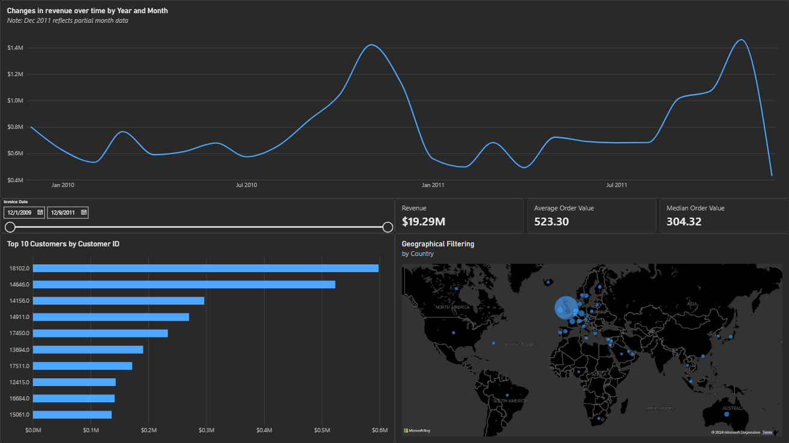

# Online Retail II Sales & Customer Dashboard

End-to-end sales and customer analytics project built on the Online Retail II dataset (`12/1/2009 – 12/9/2011`). Raw invoice data is processed through a Python and SQLite ETL pipeline into a normalized `invoices` table and connected to a Power BI report covering revenue trends, order values, seasonality, product performance, and top customers.



## Key Metrics & Findings

* **Net Revenue (£18.85M):** Computed across all rows as $\text{Net Revenue} = \sum(\text{Quantity} \times \text{Price})$. Negative quantities from returns and cancellations remain included so reported revenue reflects realized net sales rather than gross volume.
* **Order Value Skew (AOV £510.91 vs. MOV £302.22):** Average Order Value sits well above Median Order Value, indicating that high-value bulk or wholesale invoices pull the mean upward while a typical order sits closer to £302.
* **Seasonal Peaks:** Order counts and revenue build into November—reflecting combined monthly order activity across all available years in the dataset—before tapering in December.
* **Geographic Concentration:** Sales are heavily weighted toward the UK, followed by secondary markets such as Ireland, the Netherlands, Germany, and France.
* **Guest vs. Registered Customers:** Orders with missing `Customer ID` values stay included in overall revenue, order counts, and order-value metrics, but are filtered out of the Top 10 Customers visual so anonymous transactions are not misattributed to registered accounts.

## Stack

* **ETL & Storage:** Python (`pandas`, `sqlite3`, `pathlib`), SQLite
* **BI & Modeling:** Power BI, DAX

## Repository Layout

```text
OnlineRetailIIUCI/
├── README.md
├── .gitignore
├── .gitattributes
├── onlineretailanalysis.py
├── OnlineRetailAnalysis.pbix
└── dashboard.png
```

## ETL Pipeline (`onlineretailanalysis.py`)

1. Reads `online_retail_II.csv` from the project directory, trims column header whitespace, and removes duplicate rows.
2. Casts `Customer ID` to pandas nullable `Int64` (stripping `.0` decimals while preserving missing values), then converts it to `TEXT` in SQLite.
3. Builds the `invoices` table via SQL with `SELECT DISTINCT` and standardizes country labels (`EIRE` $\rightarrow$ `Ireland`, `RSA` $\rightarrow$ `South Africa`, `Unspecified` $\rightarrow$ `Unknown`).
4. Drops `raw_invoices`, commits changes, and runs `VACUUM` to reclaim disk space in `online_retail.db`.

## Power BI & DAX Design

* **Invoice-Level Aggregations:** `Average Order Value` and `Median Order Value` evaluate over `VALUES(invoices[Invoice])` (`AVERAGEX` / `MEDIANX`) so orders with multiple line items are not double-counted as separate orders.
* **Missing Customer Handling:** Blank `Customer ID` records are preserved in the model so total revenue and order counts stay accurate while Top 10 customer rankings remain restricted to identified customers.
* **Date & Currency Formatting:** Monetary metrics are formatted in GBP (`£`), and `InvoiceDate` uses the `Date` type to drive the date-range slicer and monthly trend visuals.

## Report Structure

* **KPI Cards:** Net Revenue, Average Order Value, and Median Order Value.
* **Filters & Country Breakdown:** Country slicer, `InvoiceDate` range slider, and a country revenue summary table.
* **Trends & Seasonality:** Monthly revenue over time alongside combined multi-year monthly order counts.
* **Products & Customers:** Horizontal bar visuals for product revenue by `StockCode` and Top 10 Customers (excluding missing IDs).

## Local Setup

1. Place `online_retail_II.csv` in the same folder as `onlineretailanalysis.py`.
2. Install required Python packages (such as `pandas`):
   ```bash
   pip install pandas
   ```
3. Run the ETL script to generate `online_retail.db`:
   ```bash
   python onlineretailanalysis.py
   ```
4. Open `OnlineRetailAnalysis.pbix` in Power BI Desktop, point the SQLite ODBC connection (DSN or connection string) to your local `online_retail.db` if prompted, and refresh the data.